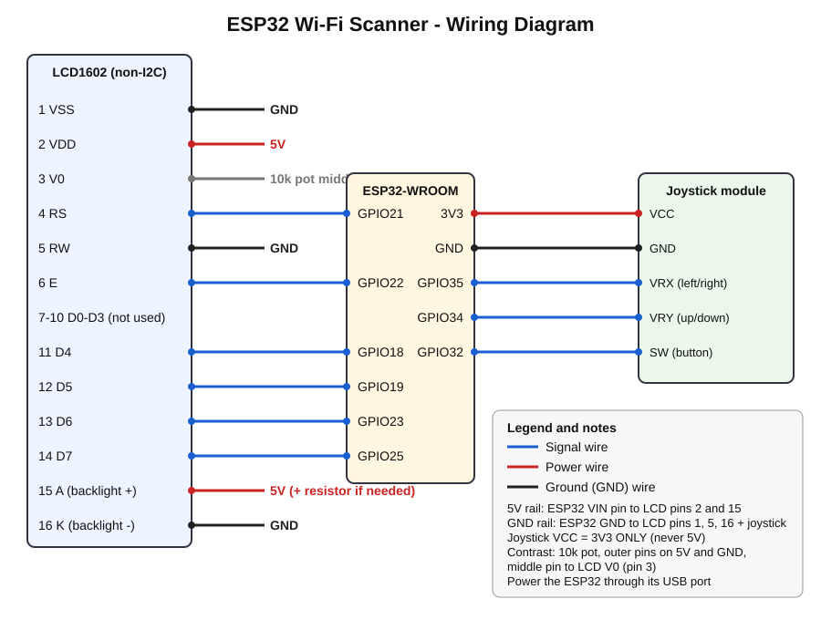

# 📡 ESP32 Wi-Fi Scanner & Security Toolkit


A pocket-sized Wi-Fi analyzer built with an **ESP32**, a **16x2 LCD**, and a **joystick**.
It scans nearby Wi-Fi networks, shows their signal and encryption, grades their security, finds the quietest channel, and flags suspicious "twin" access points.

No laptop, no app, no internet needed after flashing. Just power it up and scan.

<!-- Add a photo or GIF of your build here, for example:  -->

---

## ✨ Features

The joystick **left / right** switches between 4 modes:

| # | Mode | What it does |
|---|------|--------------|
| 1 | **WiFi Scanner** | Lists networks (SSID + RSSI), strongest first. Press to lock on and see **encryption type**, **MAC (BSSID)**, and a **live signal meter** with bars and a trend arrow. |
| 2 | **Security Audit** | Grades every network **GOOD / OK / WEAK / BAD** based on its encryption, plus a summary count. |
| 3 | **Channels** | Shows how many networks are on each channel (1-13) and suggests the best channel (1, 6, or 11). |
| 4 | **Rogue AP Check** | Finds networks that share the same name (possible **evil twins**) and rates them MULTI-AP / SUSPECT / DANGER. |

Extras: flashing **DANGER** warning on the LCD, custom signal-bar characters, joystick auto-calibration, and a long-press rescan.

---

## 🧰 Parts List

| Part | Qty |
|------|-----|
| ESP32-WROOM dev board | 1 |
| LCD1602 module (non-I2C, 16 pins) | 1 |
| Analog joystick module (with push button) | 1 |
| Breadboard | 1 |
| Jumper wires | ~25 |
| 10k potentiometer (LCD contrast) | 1 |
| Resistor for LCD backlight (only if your module has none) | 1 |

---

## 🔌 Wiring



Quick pin table (full guide in [docs/wiring.md](docs/wiring.md)):

| Part | Pin | ESP32 |
|------|-----|-------|
| LCD | RS | GPIO 21 |
| LCD | E | GPIO 22 |
| LCD | D4 / D5 / D6 / D7 | GPIO 18 / 19 / 23 / 25 |
| Joystick | VRX (left/right) | GPIO 35 |
| Joystick | VRY (up/down) | GPIO 34 |
| Joystick | SW (button) | GPIO 32 |
| Joystick | VCC | **3V3** |

> ⚠️ Power the joystick from **3V3**, never 5V. The ESP32 pins can only handle 3.3 V.

---

## 🚀 Quick Start

1. Flash **MicroPython** onto the ESP32.
2. Copy `main.py` to the board.
3. Reset the board. **Keep your hands off the joystick for the first second** (it calibrates).

Step-by-step instructions: [docs/SETUP.md](docs/SETUP.md)

---

## 🎮 Controls

| Action | What happens |
|--------|--------------|
| Joystick **left / right** | Change mode |
| Joystick **up / down** | Move through the list / pages |
| **Short press** | Select a network / go back / toggle details |
| **Long press** (1 second) | Rescan, in any mode |

Full guide with screen examples: [docs/USER_GUIDE.md](docs/USER_GUIDE.md)

---

## 🧠 How It Works (simple version)

1. The ESP32 asks the air: *"Which Wi-Fi networks are nearby?"* (`wlan.scan()`).
2. Each network answers with its **name, MAC address, channel, signal strength (RSSI), and encryption type**.
3. The code sorts them, grades them, and groups same-named ones to look for twins.
4. A small custom **LCD driver** (4-bit mode) draws everything on the screen.
5. The joystick is read with the ESP32's **ADC**. At startup the code measures the stick's resting center, so it works even if your joystick is slightly off.

### How "Rogue AP Check" decides

| Level | Rule |
|-------|------|
| **MULTI-AP** | Same name, same maker, same security (normal: routers + extenders, mesh) |
| **SUSPECT** | Same name, **different hardware maker** (first 3 bytes of MAC) |
| **DANGER** | Same name, **different encryption** (e.g. one open, one WPA2) |

This is a **heuristic** (a smart guess), not proof. Mesh systems and mixed-brand setups can trigger false alarms.

---

## 🔒 Security & Ethics

- The scanner is **passive**. It only listens to public Wi-Fi announcements.
- It **never connects to, attacks, or changes** any network.
- The ESP32's own hotspot is turned **off** so the device doesn't broadcast anything.
- Use it only to look at networks around you and to learn. Don't use it against networks you don't own or have permission to test.

---

## ⚠️ Limitations

- Sees **2.4 GHz only** (the ESP32 has no 5 GHz radio).
- Shows the **40 strongest** networks.
- Security grades are based on **encryption type only**. They don't test password strength.
- Hidden networks show as `(hidden)`.

---

## 📁 Project Structure

```
wifi-scanner/
├── main.py               # All the code
├── README.md             # You are here
├── LICENSE
└── docs/
    ├── wiring.md         # Wiring guide + pin table
    ├── wiring_diagram.svg
    ├── SETUP.md          # Flash + upload + troubleshooting
    └── USER_GUIDE.md     # Controls and screens
```

---

## 🎓 Skills Demonstrated

- Embedded programming in **MicroPython** (GPIO, ADC, timing)
- Writing a hardware driver from scratch (HD44780 LCD, 4-bit mode, custom characters)
- Wi-Fi security concepts: WEP / WPA / WPA2 / WPA3, BSSID, OUI, channel overlap, **evil twin** detection
- Analog sensor calibration and signal smoothing
- Technical documentation

---

## 🔮 Future Ideas

- Baseline watchlist (alert when a *new* network appears)
- Save scan logs to flash

---

## 📜 License

MIT. See [LICENSE](LICENSE).
