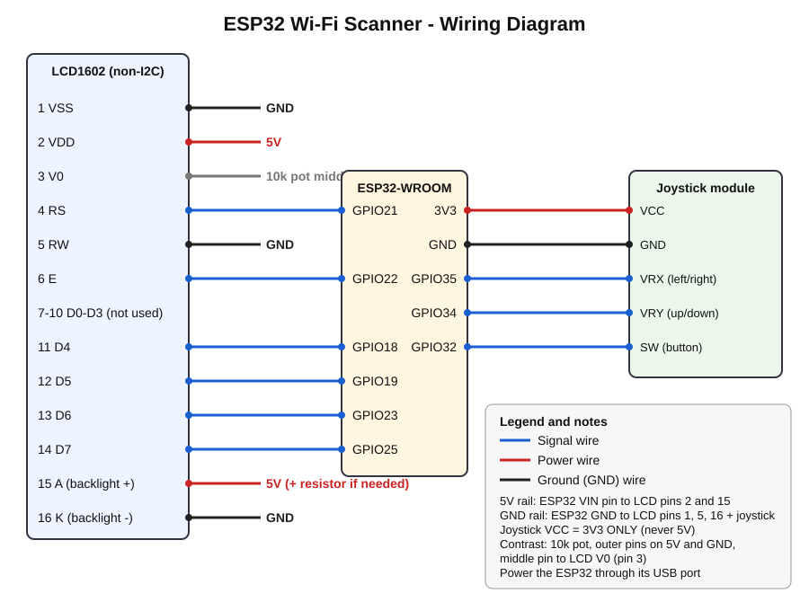

# 🔌 Wiring Guide

> Unplug USB before wiring. Double-check before powering on.

## LCD1602 (non-I2C) → ESP32

| LCD pin | Name | Connects to |
|---------|------|-------------|
| 1 | VSS | GND |
| 2 | VDD | 5V (ESP32 **VIN** pin) |
| 3 | V0 (contrast) | Middle pin of 10k potentiometer |
| 4 | RS | GPIO 21 |
| 5 | RW | GND (we only write to the LCD) |
| 6 | E | GPIO 22 |
| 7-10 | D0-D3 | Not connected |
| 11 | D4 | GPIO 18 |
| 12 | D5 | GPIO 19 |
| 13 | D6 | GPIO 23 |
| 14 | D7 | GPIO 25 |
| 15 | A (backlight +) | 5V (through a resistor if your module has none) |
| 16 | K (backlight -) | GND |

**Contrast pot:** one outer pin to 5V, the other outer pin to GND, middle pin to LCD pin 3.

## Joystick → ESP32

| Joystick pin | Connects to |
|--------------|-------------|
| VCC (+5V label on some boards) | **3V3** |
| GND | GND |
| VRX (left/right) | GPIO 35 |
| VRY (up/down) | GPIO 34 |
| SW (button) | GPIO 32 |

The button uses the ESP32's internal pull-up, so no extra resistor is needed. Pressed = connected to GND.

## Tips

- **Why 3V3 for the joystick?** GPIO 34 and 35 are analog inputs that must never see more than 3.3 V.
- **Pins 34 and 35** are input-only on the ESP32, which is perfect for the joystick.
- **LCD on 5V with 3.3V signals** works on most LCD1602 modules. If yours stays blank, see [SETUP.md](SETUP.md#troubleshooting).
- Want different pins? Change the pin numbers at the top of `main.py`.
